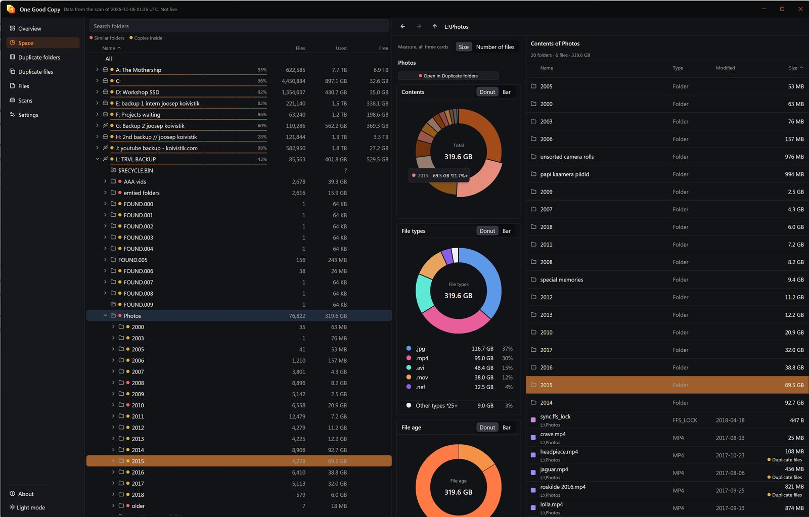

<h1 align="center">
  <a href="https://onegoodcopy.com/">
    <picture>
      <source media="(prefers-color-scheme: dark)" srcset=".github/assets/lockup-dark.svg">
      
    </picture>
  </a>
</h1>

<p align="center"><b>Find duplicate folders and photos across all your drives, and see what fills them.</b><br>
Free · no ads · no account · fully offline</p>

<p align="center">
  <a href="https://apps.microsoft.com/detail/9mvqsrqnnrh0"></a>
  <a href="../../releases"></a>
  
</p>

<p align="center">
  <a href="https://onegoodcopy.com/">Website</a> &nbsp;•&nbsp;
  <a href="#install">Install</a> &nbsp;•&nbsp;
  <a href="../../issues/new/choose">Report a bug or ask for a feature</a>
</p>

<p align="center">
  
</p>
<p align="center"><sub>Space view: every drive, every folder, what fills it.</sub></p>

---

## What it does

Built for scattered photo backups across many drives. It finds folders that are copies of each other, even after they were renamed, reorganized, or had photos re-exported in another format or size. It reads only the drives you choose and deletes only what you confirm.

<table>
  <tr>
    <td width="50%" valign="top">

**Duplicate folders**<br>
Finds matching folder trees across disks and lines them up side by side.

</td>
    <td width="50%" valign="top">

**Photo families**<br>
Groups RAWs, camera JPEGs, edits and resized exports. Never suggests deleting a RAW for its export.

</td>
  </tr>
  <tr>
    <td width="50%" valign="top">

**Space map**<br>
What fills each drive, folder by folder, by type and age.

</td>
    <td width="50%" valign="top">

**Instant search**<br>
All files on all drives in about a second. Filter by type, age, camera or lens.

</td>
  </tr>
</table>

Photos match by metadata and visual fingerprint. Other files match by exact size and BLAKE3 hash.

## Speed

First full scan, empty catalog. Rescans only check folders that changed.

| Setup | Data | Time |
|---|---:|---:|
| One SATA SSD | 451 GB, 1.17M files | 1:18 |
| 9 drives (SSD, HDD, USB) | 17.2 TB, 6.9M files | 52:55 |

## Install

> [!NOTE]
> Linux and macOS builds here come with no support promise. Files only: no source is published here.

### Windows

Get it from the [Microsoft Store](https://apps.microsoft.com/detail/9mvqsrqnnrh0), or in a terminal:

```bash
winget install --id 9MVQSRQNNRH0 --source msstore
```

### Linux (x86_64)

Latest release: [v0.2.0](https://github.com/equilerex/one-good-copy-drive-scanner-app/releases/tag/v0.2.0). AppImage:

```bash
wget https://github.com/equilerex/one-good-copy-drive-scanner-app/releases/download/v0.2.0/one-good-copy-0.2.0-linux-x86_64.AppImage
chmod +x one-good-copy-0.2.0-linux-x86_64.AppImage
./one-good-copy-0.2.0-linux-x86_64.AppImage
```

Or the tarball:

```bash
wget https://github.com/equilerex/one-good-copy-drive-scanner-app/releases/download/v0.2.0/one-good-copy-0.2.0-linux-x86_64.tar.gz
tar -xzf one-good-copy-0.2.0-linux-x86_64.tar.gz
./one-good-copy-0.2.0-linux-x86_64/one-good-copy
```

<details>
<summary><b>Requirements and troubleshooting</b></summary>

- glibc 2.35 or newer (built on Ubuntu 22.04).
- A Wayland or X11 desktop with Vulkan drivers.
- The AppImage needs FUSE 2 (`libfuse2`). Without it, run `./one-good-copy-0.2.0-linux-x86_64.AppImage --appimage-extract-and-run` or use the tarball.
- The folder picker uses `xdg-desktop-portal` with a GTK, GNOME or KDE backend.
- Minimal systems may need (Ubuntu and Debian names): `libxkbcommon-x11-0`, `libxcb-xkb1`, `libvulkan1`, `libfontconfig1`, `libwayland-client0`.

Check the download, in the same folder:

```bash
wget https://github.com/equilerex/one-good-copy-drive-scanner-app/releases/download/v0.2.0/SHA256SUMS
sha256sum -c --ignore-missing SHA256SUMS
```

</details>

### macOS (Apple Silicon)

Coming soon.

## Your data

Catalog and logs live in `~/.local/share/one-good-copy` (or `$XDG_DATA_HOME/one-good-copy`), logs in its `logs` folder. To uninstall, delete the app and that folder.

The app collects and sends no data. See the [privacy page](https://onegoodcopy.com/privacy).

## Bugs and feature requests

[Open an issue](../../issues/new/choose). The bug form asks for what helps most. Every issue is read.

> [!TIP]
> Attach the end of `logs/app.log`, plus any `crash-*.log` if the app closed by itself. Look through them first: they list folder and file names from your scans.

## Updates

No auto-update. Use **Watch** on this repository to hear about new releases.

## Licence

See `EULA.txt` in each download. Third-party notices are in each archive.
